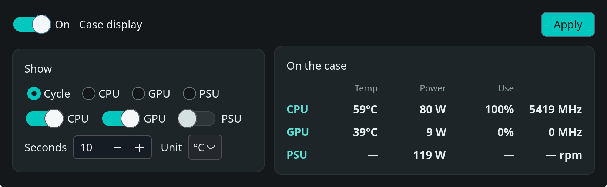

# CH170 DIGITAL display driver for SteamOS

Userspace driver for the DeepCool CH170 DIGITAL case panel.

The panel is a USB HID device, `3633:0013`. The kernel binds it as a generic HID device. This driver sends live CPU, GPU, and PSU readings over that connection and includes a settings window.

Not affiliated with DeepCool. Report byte positions follow the CH170 page of [deepcool-digital-linux](https://github.com/Nortank12/deepcool-digital-linux).



## Pages

Each page shows four values, left to right. The panel firmware chooses the labels.

| Page | Values |
|---|---|
| CPU | temperature, power, usage, clock |
| GPU | temperature, power, usage, clock |
| PSU | temperature, power, usage, fan |

CPU and GPU clocks are MHz. The fan value is only on the PSU page.

## Requirements

Python 3 and GTK 4. Both ship with SteamOS.

## Install

From this directory:

```bash
sudo ./bin/install-system.sh
```

This installs:

- a udev rule for the panel and for the CPU energy counter
- `deepcool-digital.service`, enabled at boot
- the **CH170 Display** application menu entry
- `~/.local/bin/ch170-display`

## Use

Open **CH170 Display** from the application menu, or run:

```bash
ch170-display
```

The window selects the page or the cycle, how long each page stays up, Celsius or Fahrenheit, and the PSU estimate. **On** stops and resumes the panel without uninstalling. Apply writes `config/display.json`. The service reloads that file on the next update.

## Remove

Stops the service and deletes the unit, the udev rule, the menu entry, and the `ch170-display` launcher. The project directory stays.

```bash
sudo ./bin/uninstall-system.sh
```

## Preview

Print one sample without writing to the panel:

```bash
PYTHONPATH=. python3 -m deepcool_ch170 --preview
```

## Tests

```bash
PYTHONPATH=. python3 -m unittest tests.test_display
```

## Documentation

- [Operation and configuration](docs/ch170-display.md)
- [Device and sensors](docs/device.md)
